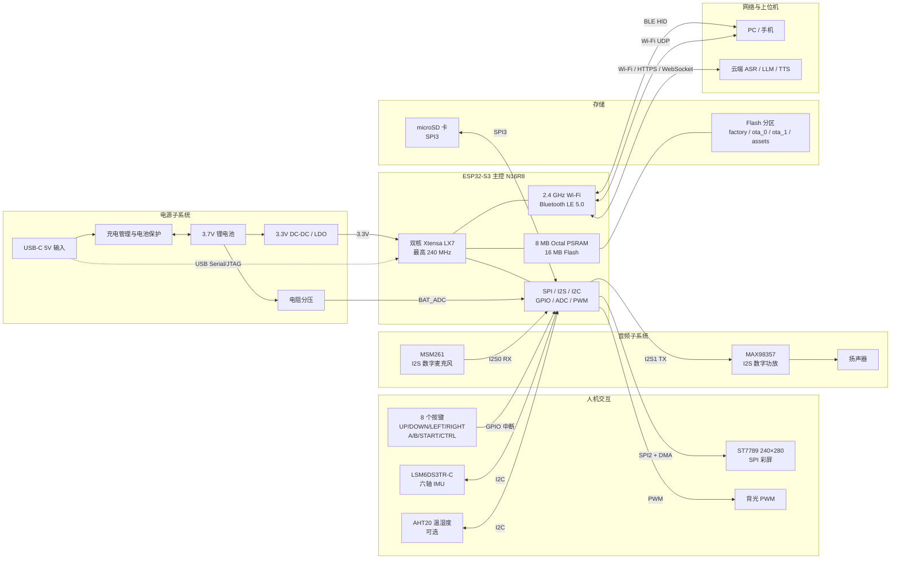
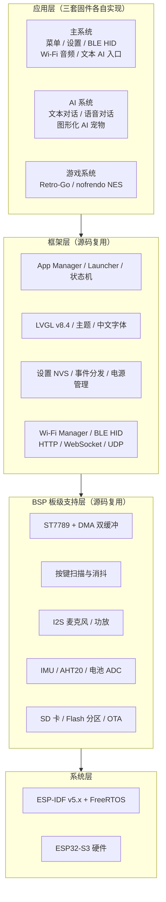

# 01 · 系统框图

> 对应《手柄实现方案》与《选题申请表》中的“系统总体方案与硬件设计”“双固件分区规划”。  
> 目标：在单块 ESP32-S3 上，用三套独立固件承载主系统、游戏系统与 AI 系统，并共用一套板级驱动源码。

## 1. 设计目标

| 维度 | 目标 |
|---|---|
| 主控 | ESP32-S3，双核 Xtensa LX7，最高 240 MHz |
| 存储 | 8MB Octal PSRAM + 16MB Flash |
| 显示 | ST7789 240×280 SPI 彩屏，LVGL v8.4 |
| 输入 | 8 键：UP / DOWN / LEFT / RIGHT / A / B / START / CTRL |
| 音频 | MSM261 数字麦克风（I2S RX）+ MAX98357 数字功放（I2S TX） |
| 传感 | LSM6DS3TR-C 六轴 IMU；AHT20 温湿度（可选） |
| 存储 | microSD（ROM / 资源 / 存档） |
| 无线 | Wi-Fi 2.4GHz（云端 AI、UDP 音频、资源下载）；BLE 5.0（HID 键盘/手柄） |
| 电源 | 锂电池 + 充电/保护 + 3.3V 稳压 + ADC 电量采样 |
| 系统形态 | `factory` 主系统 / `ota_0` 游戏 / `ota_1` AI，三固件切换 |

## 2. 总体系统框图

### 框图说明

- **显示与 SD 卡分总线**：ST7789 走 `SPI2_HOST`，SD 卡走 `SPI3_HOST`，避免屏幕 DMA 刷新被 SD 读写阻塞。
- **音频双 I2S**：麦克风走 `I2S0`（RX），功放走 `I2S1`（TX），可同时录音与播放，便于语音对话和“打断”。
- **按键独立 GPIO**：8 个按键全部用 GPIO 上拉 + 低有效，按下产生中断，软件 10–20ms 消抖。
- **电源采样**：电池经电阻分压进 ADC，软件换算电量；低电时先降背光、关无线，再进入保护。
- **无线分时**：BLE HID 与 Wi-Fi 不同时高负载使用；游戏手柄模式以 BLE 为主，Wi-Fi 音频模式以 Wi-Fi 为主。

## 3. 软件分层框图

三套固件是**三个独立二进制**，但共享同一套 BSP 与驱动源码，避免重复造轮子。

> 注意：这里的“复用”是**源码级复用**，不是三套固件同时运行。任一时刻只有一个固件在跑，另外两套在 Flash 里休眠。

### 任务划分（主系统示例）

| 任务 | 优先级 | 栈建议 | 职责 |
|---|---|---|---|
| `lvgl_task` | 中 | 8–12KB | LVGL 刷新、界面事件、动画 |
| `key_task` | 中高 | 3–4KB | 按键扫描、消抖、组合键识别 |
| `audio_task` | 高 | 4–6KB | I2S 录音/播放、环形缓冲 |
| `net_task` | 低 | 6–8KB | Wi-Fi 连接、HTTP/WebSocket、UDP |
| `power_task` | 低 | 3KB | 电池采样、低电保护、休眠 |
| `app_task` | 中 | 6–8KB | 当前应用主循环、状态切换 |

> 具体优先级按实测调整；音频与屏幕 DMA 相关任务优先级应高于网络与 UI 动画。

## 4. Flash 分区与三固件切换

### 4.1 16MB Flash 分区表

| 分区 | 偏移 | 大小 | 内容 | 说明 |
|---|---|---|---|---|
| `nvs` | `0x9000` | 16KB | 设置、Wi-Fi、主题、API Key | 三套固件共享 |
| `otadata` | `0xD000` | 8KB | 启动分区选择 | 切换固件的关键 |
| `phy_init` | `0xF000` | 4KB | RF 校准 | 固定 |
| `factory` | `0x10000` | 4MB | 主系统 | 默认启动 |
| `ota_0` | `0x410000` | 4MB | 游戏系统（Retro-Go） | 菜单切换 |
| `ota_1` | `0x810000` | 4MB | AI 系统 | 菜单切换 |
| `assets` | `0xC10000` | 约 4MB | SPIFFS 资源 | 字体、表情、音效 |

> 如果 Flash 只有 8MB，无法放下三个 4MB 应用分区。此时建议：`factory` 4MB + `ota_0` 3MB + `assets` 1MB，取消独立 AI 固件，AI 作为主系统内的一个应用（功能与稳定性都会下降）。

### 4.2 切换机制

**为什么必须重启**：ESP-IDF 的 `esp_ota_set_boot_partition()` 只改变下次启动分区，不会释放当前堆。重启后 Bootloader 重新建立堆与任务，才能彻底清空 RAM，达到“消灭内存碎片”的目的。

**回退策略**：

- `otadata` 无效或目标分区校验失败 → Bootloader 回退 `factory`。
- 子固件启动后 10 秒内未收到“健康心跳” → 主系统下次启动时清除切换标志（可选增强）。
- 任何子固件内按住 `START + B` 1.5 秒 → 切回 `factory`。

## 5. 硬件接口与引脚分配

> 下表以参考项目 Rev2 为基线，**不是最终 PCB 约束**。打板前必须核对模组 datasheet、Strapping 引脚、PSRAM/Flash 占用引脚与 ADC 可用性。

### 5.1 显示（SPI2）

| 信号 | 参考 GPIO | 说明 |
|---|---|---|
| LCD_SCK | GPIO21 | SPI 时钟 |
| LCD_MOSI | GPIO14 | SPI 数据 |
| LCD_CS | GPIO42 | 片选 |
| LCD_DC | GPIO44 | 数据/命令 |
| LCD_RST | GPIO13 | 复位 |
| LCD_BL | GPIO43 | 背光 PWM |

### 5.2 SD 卡（SPI3）

| 信号 | 参考 GPIO | 说明 |
|---|---|---|
| SD_CS | GPIO38 | 片选 |
| SD_CLK | GPIO40 | 时钟 |
| SD_MOSI | GPIO39 | 数据 |
| SD_MISO | GPIO41 | 数据 |

### 5.3 音频（I2S）

| 信号 | 参考 GPIO | 说明 |
|---|---|---|
| MIC_BCLK | GPIO11 | MSM261 位时钟（I2S0） |
| MIC_WS | GPIO12 | MSM261 字选择（I2S0） |
| MIC_DATA | GPIO10 | MSM261 数据（I2S0） |
| AMP_BCLK | GPIO46 | MAX98357 位时钟（I2S1） |
| AMP_LRC | GPIO9 | MAX98357 左右声道时钟（I2S1） |
| AMP_DIN | GPIO3 | MAX98357 数据（I2S1） |

### 5.4 I2C 传感器

| 信号 | 参考 GPIO | 说明 |
|---|---|---|
| I2C_SDA | GPIO1 | IMU + AHT20 |
| I2C_SCL | GPIO2 | IMU + AHT20 |

| 器件 | 地址 | 说明 |
|---|---|---|
| AHT20 | `0x38` | 温湿度，可选 |
| LSM6DS3TR-C | `0x6A` | 六轴 IMU，SA0 接 VDD |

### 5.5 按键

| 按键 | 参考 GPIO | 功能 |
|---|---|---|
| UP | GPIO16 | 上 / 音量+ |
| DOWN | GPIO15 | 下 / 音量− |
| LEFT | GPIO17 | 左 |
| RIGHT | GPIO7 | 右 / Wi-Fi 音频 PTT |
| A | GPIO4 | 确认 / 游戏 A / AI 说话 |
| B | GPIO5 | 返回 / 游戏 B |
| START | GPIO6 | 菜单 / 游戏开始 |
| CTRL | GPIO47（建议） | 键盘修饰键；若 PCB 只有 7 键，用长按 START 复用 |

### 5.6 其他

| 信号 | 参考 GPIO | 说明 |
|---|---|---|
| BAT_ADC | GPIO8（建议） | 电池分压采样；注意部分开发板 GPIO8 接 RGB LED |
| LED | GPIO18 | 状态指示灯 |
| BOOT | GPIO0 | 下载模式 |
| USB | USB-C | 充电 + USB Serial/JTAG 烧录 |

> **引脚复核清单**：GPIO0/3/45/46 为 Strapping 引脚；N16R8 的 Octal PSRAM 会占用部分 GPIO（常见 35–37），不可挪作他用。打板前用 `esptool.py flash_id` 与模组规格书逐项确认。

## 6. 关键数据流

| 数据流 | 路径 | 关键点 |
|---|---|---|
| 游戏画面 | nofrendo 帧缓冲 → RGB565 → SPI2 DMA → ST7789 | PSRAM 帧缓冲 + 内部 DMA  bounce buffer |
| 游戏音频 | APU → 环形缓冲 → I2S1 → MAX98357 | 缓冲 2–3 帧，防欠载 |
| 语音上行 | MSM261 → I2S0 → PCM 环形缓冲 → Opus → Wi-Fi → 云端/PC | 16kHz / 16bit / 单声道 |
| 语音下行 | 云端 TTS / PC → Opus → I2S1 → MAX98357 | 24kHz 或 16kHz，按服务端返回 |
| AI 文本 | LVGL 键盘 → UTF-8 → HTTPS JSON → 流式响应 → LVGL | 分块显示，避免一次性大缓冲 |
| BLE HID | 按键扫描 → HID report → GATT Notify → PC/手机 | 键盘与手柄两种 report |
| Wi-Fi 音频 | MSM261 → PCM → UDP → PC 接收端 | 局域网，目标端到端 <300ms |
| 游戏下载 | PC/云端 HTTP → SD 卡 `/roms/nes` | 断点/校验后刷新游戏列表 |
| 固件切换 | 菜单 → `esp_ota_set_boot_partition()` → `esp_restart()` | 先保存设置/存档 |

## 7. 关键设计决策

### 7.1 三固件而不是单固件多页面

| 方案 | 优点 | 缺点 | 结论 |
|---|---|---|---|
| 单固件多页面 | 切换快、共享内存 | LVGL + NES + 语音 + 网络长期运行易碎片化/OOM | 不采用 |
| 三固件分区 | 每次切换清空 RAM；故障隔离；可独立编译 | 每次切换重启 3–5 秒；Flash 占用 12MB | **采用** |

### 7.2 8 键与 CTRL 的实现

《手柄实现方案》要求“在原来上下左右 AB 的基础上加一个 CTRL”。有两种落地方式：

1. **独立 CTRL 键（推荐）**：PCB 增加第 8 个按键，接 GPIO47。组合键识别最干净。
2. **长按 START 复用**：保持 7 键硬件，长按 START ≥300ms 进入“CTRL 修饰”状态，再按方向键。缺点是组合键时序复杂，游戏与键盘模式容易误触。

> 本方案默认按“独立 CTRL 键”设计；若指导老师要求 7 键，则退回方案 2，并在设置中提供“CTRL 复用”开关。

### 7.3 键盘映射

| 模式 | 按键 | HID 输出 |
|---|---|---|
| 键盘 | A | `Enter` |
| 键盘 | B | `Backspace` |
| 键盘 | START | `Esc` |
| 键盘 | CTRL + LEFT | `Ctrl + A`（全选） |
| 键盘 | CTRL + RIGHT | `Ctrl + X`（剪切） |
| 键盘 | CTRL + UP | `Ctrl + V`（粘贴） |
| 键盘 | CTRL + DOWN | `Ctrl + C`（复制） |
| 键盘 | 方向键 | 方向键 |
| 手柄 | A/B/方向/START | HID Gamepad 对应按钮 |
| 手柄 | IMU（可选） | 倾斜映射为摇杆/视角 |

> 这是按《手柄实现方案》的约定，不是 PC 通用快捷键。若使用者更习惯标准快捷键，可在设置里提供“方向键映射”与“标准 Ctrl 映射”两套配置。

### 7.4 AI 放在独立固件

主系统只保留“AI 助手”入口，点击后切到 `ota_1`。原因：

- AI 需要 Wi-Fi + 音频 + 编解码 + LVGL 动画，堆占用大；
- 与游戏、主系统隔离，避免 AI 网络异常拖垮主系统；
- 切换重启后 RAM 干净，语音缓冲更容易分配。

### 7.5 屏幕与 NES 分辨率的适配

- ST7789 玻璃可视区 240×280，控制器显存 240×320，初始化需设置 `Y offset = 20`。
- NES 原生 256×240。优先**等比缩放 + 左右裁切**到 240×240，上下留 20px 状态栏/黑边；也可整屏拉伸到 240×280，但像素会略变形。
- 缩放用最近邻，避免双线性带来的额外 CPU 开销。

### 7.6 电源与低电保护

| 阈值 | 动作 |
|---|---|
| 电量 ≤ 20% | 状态栏变红，提示充电 |
| 电压 < 3.4V | 降低背光至 30%，关闭 Wi-Fi/BLE |
| 电压 < 3.3V | 保存设置/存档，进入深度睡眠或提示关机 |
| 空闲 30s | 背光降到 50% |
| 空闲 60s | Light Sleep，任意按键唤醒 |

> 参考项目的休眠存在“睡死唤不醒”的已知问题。本项目必须单独验证 `gpio_wakeup_enable()` + `esp_light_sleep_start()` 的唤醒路径，并在第 13 周做 100 次睡眠/唤醒循环测试。

## 8. 与参考项目的对应关系

| 本方案模块 | 参考项目对应 | 复用方式 |
|---|---|---|
| 主系统框架 | `main/app` + `main/ui` + `main/modules` | 复用架构，删减天气/占卜/频谱 |
| 显示与按键 | `main/bsp/st7789_driver.c`、`key_driver.h` | 改引脚后复用 |
| 音频 | `main/modules/audio` | 复用 I2S 配置，改采样率/增益 |
| BLE HID | `main/modules/pc_remote/ble_hid.c` | 复用，增加 Ctrl 映射 |
| Wi-Fi 音频 | `main/modules/pc_remote/wifi_audio.c` | 复用 UDP 方案 |
| 游戏系统 | `retro-go-firmware/` + `components/retro-go` | 复用 Retro-Go 与 nofrendo |
| AI 系统 | `xiaozhi-zistar-main/` | 复用板级配置与语音链路，增加宠物界面 |
| 分区与切换 | `partitions.csv` + 菜单切换逻辑 | 复用三分区布局 |

详细拆解见 [04-参考项目分析.md](04-参考项目分析.md)。
