# 02 · 子系统流程图

> 本文把设备拆成三个独立固件子系统：**主系统（factory）**、**AI 系统（ota_1）**、**游戏系统（ota_0）**。  
> 每个子系统给出启动流程、核心状态机/时序、异常处理。图中的按键约定见第 4 节。

## 0. 阅读说明

- 三套固件共享 BSP 与驱动源码，但**不同时运行**；任一时刻只有一个固件占用 CPU、RAM 与外设。
- 所有“切回主系统”的动作，最终都是 `esp_ota_set_boot_partition(factory)` + `esp_restart()`。
- 图中的超时、阈值都是首版默认值，联调时按实测调整。

---

## 1. 主系统（factory）

主系统负责：开机、菜单、设置、电源管理、BLE HID、Wi-Fi 音频、AI/游戏入口、文件与资源管理。

### 1.1 启动流程

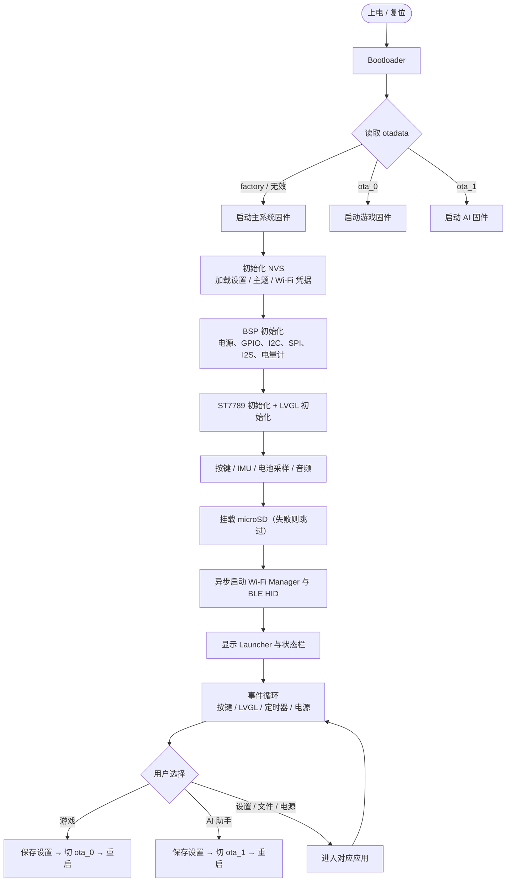

**启动顺序的硬性要求**：

1. 先初始化 NVS，再读设置；否则亮度、音量、主题会丢。
2. 先初始化电源与 GPIO，再初始化屏幕；本板背光电路有 10k 上拉，**上电默认常亮**，应尽早把 GPIO44 拉低，屏幕初始化完成后再 PWM 点亮，避免开机白屏/闪白。
3. Wi-Fi 与 BLE 必须**异步**启动，不能阻塞 Launcher 显示；否则开机黑屏 3–5 秒。
4. 按键中断在系统初始化完成前不处理，防止初始化期间误触导致重启（参考项目踩过这个坑）。

### 1.2 应用状态机

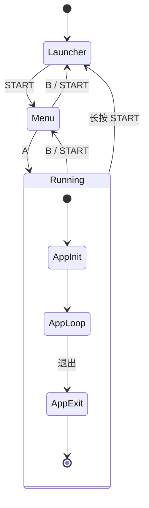

| 状态 | 界面 | 按键行为 |
|---|---|---|
| `Launcher` | 主屏：时间、电量、Wi-Fi、应用卡片 | 方向键切换卡片；A 进入；START 打开菜单 |
| `Menu` | 应用网格：游戏、AI、设置、文件、电源 | 方向键导航；A 确认；B/START 返回 |
| `Running` | 当前应用界面 | 由应用自己处理；B/START 返回菜单 |

### 1.3 固件切换时序

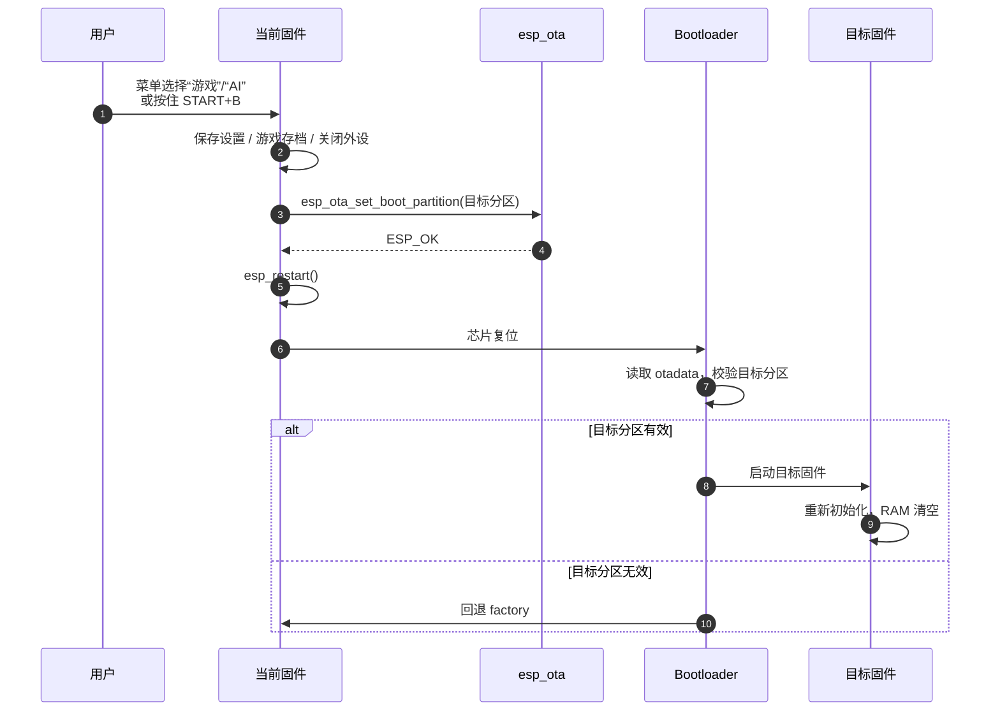

**切换前必须做的事**：

- 保存音量、亮度、主题、Wi-Fi 凭据到 NVS。
- 游戏系统保存 SRAM/存档到 SD；AI 系统保存对话摘要与宠物状态。
- 关闭 I2S、DMA、Wi-Fi/BLE，避免重启瞬间的爆音或 Flash 写冲突。

### 1.4 电源管理流程

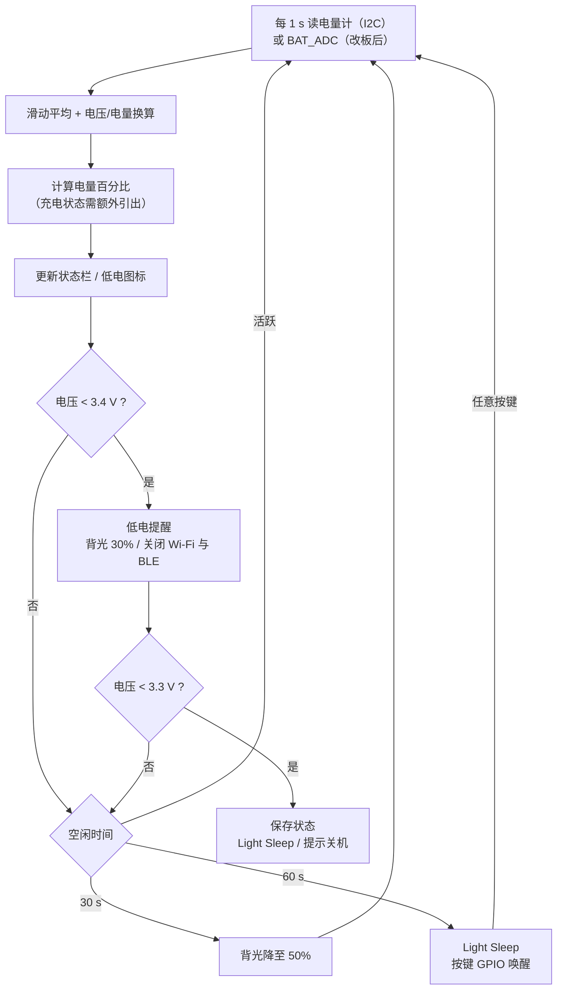

> **当前 PCB 前提**：`Gerber_PCB1_2026-10-27` 没有 BAT_ADC/电量计；TP4056 的 CHRG/STDBY 只接 LED，也没有接到 MCU。未补装 I2C 电量计（MAX17048/ADS1115）前，本节电量百分比、充电状态与低电压保护都无法实现；可先做运行时间估算，但不能作为验收。详见 [05-PCB核对与改板建议.md](05-PCB核对与改板建议.md#p0-1--没有电池电压采样--电量计)。

> **休眠验证**：参考项目存在“睡死唤不醒”的问题。本项目要求：
> 1. 只用 `gpio_wakeup_enable()` + `esp_light_sleep_start()`，不使用深睡作为默认路径；
> 2. 唤醒后重新初始化 I2S 与屏幕背光；
> 3. 第 13 周做 100 次睡眠/唤醒循环，成功率 100% 才验收。

### 1.5 主系统功能入口

| 入口 | 行为 | 依赖 |
|---|---|---|
| 游戏 | 切 `ota_0`，重启进 Retro-Go | SD 卡、分区表 |
| AI 助手 | 切 `ota_1`，重启进 AI 系统 | Wi-Fi（可选） |
| BLE 键盘 / 手柄 | 停留主系统，启动 BLE HID | BLE 协议栈 |
| Wi-Fi 音频 | 停留主系统，采集麦克风 → UDP → PC | Wi-Fi、PC 接收端 |
| 设置 | 音量、亮度、主题、按键映射、Wi-Fi 配网 | NVS |
| 文件 | 浏览 SD 卡、删除/复制 ROM 与资源 | SD 卡 |
| 游戏下载 | 通过 Wi-Fi 从 PC/云端下载 ROM 或资源到 SD | Wi-Fi、SD、HTTP |
| 电源 | 电量、休眠、关机（充电状态需额外引出） | 电量计（I2C）或改板后的 ADC |

### 1.6 Wi-Fi 游戏/资源下载

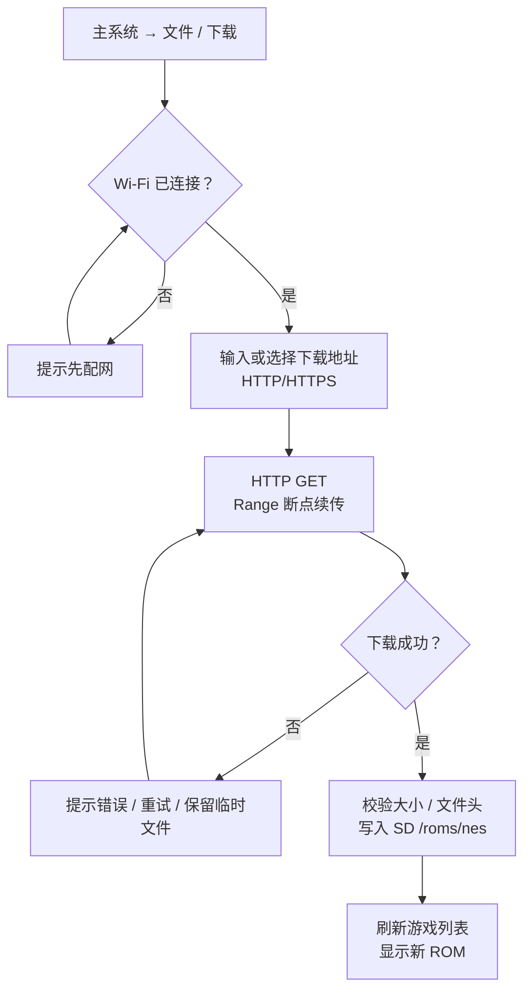

> 首版只做“单文件下载 + 校验”，不做完整的应用商店。下载任务放在低优先级任务，显示进度条，允许取消；下载中不进入游戏系统，避免 SD 写冲突。

---

## 2. AI 子系统（ota_1）

AI 子系统负责：Wi-Fi/配网、文本对话、语音对话、图形化 AI 宠物、云端 ASR/LLM/TTS 接入。

### 2.1 启动与联网

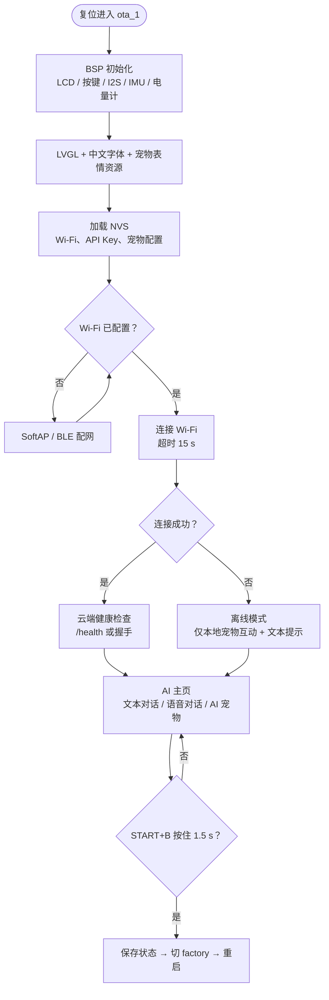

**配网方式（二选一，首版建议都保留）**：

1. **SoftAP 配网**：设备开热点，手机连上后打开配置页填写 SSID/密码；实现简单，UI 可用 LVGL 显示二维码。
2. **BLE 配网**：手机 App 通过 BLE 写入 Wi-Fi 凭据；体验好，但开发量大。

> 参考项目使用 `esp-wifi-connect` 组件做配网，可直接复用其 SoftAP 流程。

### 2.2 文本对话时序

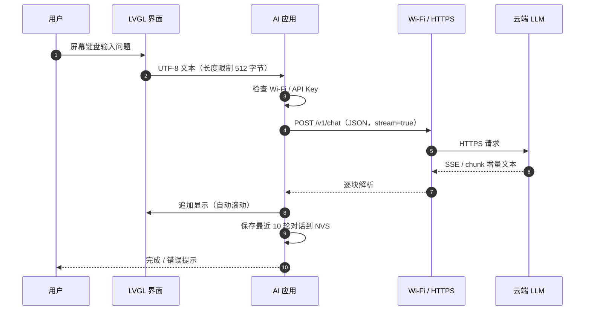

**实现要点**：

- 输入框限制长度，避免 LVGL 文本控件与 JSON 缓冲过大。
- 使用流式响应（SSE 或 chunked），第一段文本到达即显示，降低“卡住”的感知。
- 超时 15 秒，失败重试 2 次（指数退避）；仍失败则提示“网络/服务不可用”。
- API Key 存 NVS，不写死在代码里；配网页面可修改。

### 2.3 语音对话时序

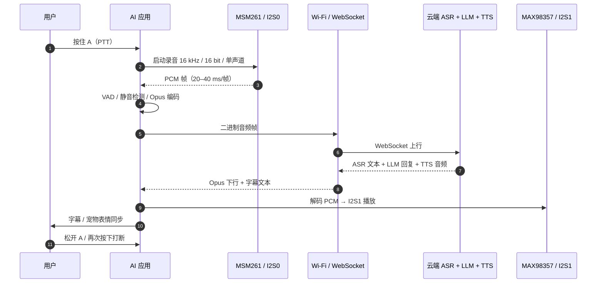

**协议选择**：

| 方案 | 优点 | 缺点 | 建议 |
|---|---|---|---|
| WebSocket 全双工 | 实现简单，浏览器/服务端都支持 | 延迟略高于 UDP | **首版采用** |
| MQTT + UDP | 参考 XiaoZhi 的方案，延迟低 | 服务端与 NAT 穿透复杂 | 进阶 |
| HTTP 分段上传 | 最简单 | 延迟高，不适合实时语音 | 不采用 |

**音频参数**：麦克风 16kHz/16bit；TTS 常见 24kHz，按服务端返回重采样到 I2S 支持的速率。Opus 编码优先，若服务端只收 PCM，则用 16kHz PCM + 压缩传输。

### 2.4 图形化 AI 宠物状态机

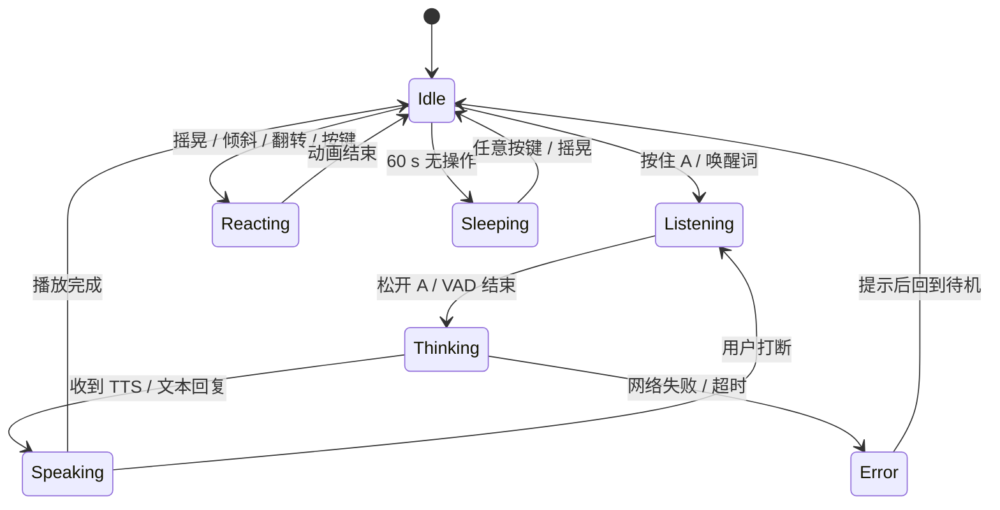

### 2.5 多模态输入映射

| 输入 | 检测方式 | 宠物反应 | 是否走云端 |
|---|---|---|---|
| A 短按 | 按下 < 300ms | 摸摸头 / 开心表情 + 音效 | 否 |
| A 长按 | 按下 ≥ 300ms | 进入 `Listening`，录音 | 是（语音） |
| B | 短按 | 返回 / 取消当前动作 | 否 |
| 摇晃 | IMU 加速度方差 > 阈值 | 眩晕 / 转圈动画 | 否 |
| 左/右倾斜 | IMU 姿态角 | 向左/右倾斜、贴边动画 | 否 |
| 屏幕朝下翻转 | IMU z 轴 | 睡觉 / 打呼音效 | 否 |
| 语音指令 | ASR 文本意图 | 按意图播放动作 + 语音回复 | 是 |
| 温湿度（可选） | AHT20 | “好热 / 好冷”环境评论 | 可选 |
| 低电 | 电量计（I2C） | 困倦 / 提醒充电 | 否 |

> 本地反应优先：按键、IMU 动作不依赖网络，保证断网也能玩；语音与文本才走云端。

### 2.6 AI 子系统异常与降级

| 场景 | 检测 | 处理 |
|---|---|---|
| Wi-Fi 未配置 | NVS 无凭据 | 进入配网页面，宠物待机可用 |
| Wi-Fi 连接失败 | 15s 超时 | 离线模式，每 30s 重试一次，不阻塞 UI |
| 云端超时 | 15s 无首包 | 提示“网络开小差”，重试 2 次 |
| API 401/403 | HTTP 状态码 | 提示检查 API Key，跳转设置 |
| API 429 | HTTP 状态码 | 提示“请求太频繁”，退避 30s |
| 音频欠载 | 环形缓冲低于 1 帧 | 插入静音，记录日志，不崩溃 |
| 内存不足 | `heap_caps_get_free_size` 低于阈值 | 停止动画/释放缓存；仍低则切回 factory |
| WebSocket 断开 | 心跳超时 | 指数退避重连（1s/2s/4s，最多 30s） |
| 看门狗 | 任务超时 | 保存状态 → 重启；连续 3 次则回 factory |

---

## 3. 游戏子系统（ota_0）

游戏子系统负责：Retro-Go 启动器、NES 模拟器、ROM 加载、画面/音频输出、存档与退出。

### 3.1 启动与选游戏

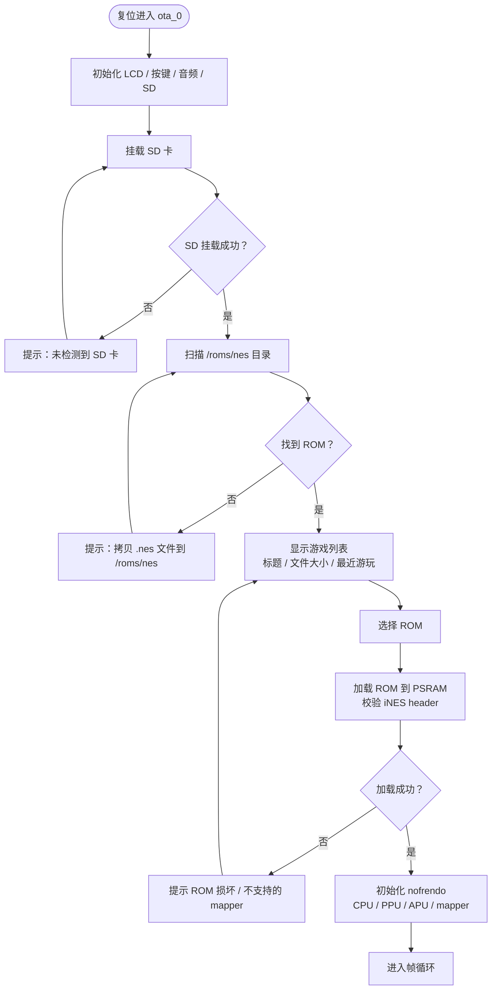

### 3.2 帧循环

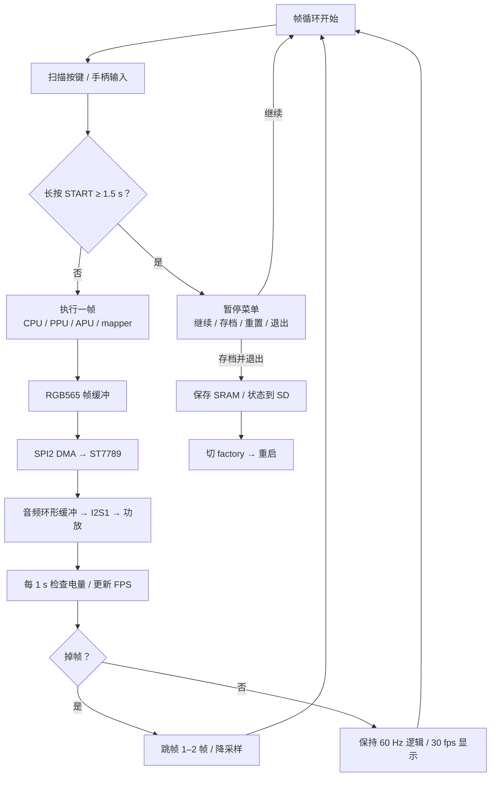

> NES 逻辑帧率是 60Hz（NTSC）。ESP32-S3 上首版目标“稳定 30fps 显示 + 60Hz 逻辑”，即每显示一帧跑两次逻辑，或开启跳帧。性能富余时再冲 60fps。

### 3.3 存档与退出

| 动作 | 实现 |
|---|---|
| 即时存档 | 保存 CPU/PPU/APU 寄存器 + RAM + mapper 状态到 SD |
| 电池存档 | 保存 SRAM 到 `.sav` 文件，退出/切游戏时写回 |
| 退出到主系统 | 先 `fsync` 存档，再 `esp_ota_set_boot_partition(factory)` + `esp_restart()` |
| 异常退出 | 看门狗重启后进入游戏列表，不自动加载上次 ROM，避免坏档循环 |

### 3.4 性能策略

| 瓶颈 | 策略 |
|---|---|
| PPU 渲染 | 只渲染可见扫描线；帧缓冲放 PSRAM，DMA 用内部 RAM bounce buffer |
| SPI 刷屏 | 40–80MHz，DMA 双缓冲；一帧分 2–4 块传输，避免长时间占用总线 |
| 音频 | APU 输出环形缓冲 2–3 帧；I2S DMA 中断填充，禁止在中断里做重活 |
| 输入 | 10ms 扫描 + 20ms 消抖；组合键在应用层识别 |
| 跳帧 | 根据 `esp_timer` 实测帧耗时动态跳 0–2 帧 |
| ROM 加载 | 整块读入 PSRAM；避免运行时反复读 SD |

---

## 4. 三子系统共用的按键约定

| 场景 | 按键 | 行为 |
|---|---|---|
| 全局 | `START + B` 按住 1.5s | 从 AI/游戏切回主系统（主系统内为无操作） |
| 主系统 Launcher | 方向键 | 切换卡片 |
| 主系统 Launcher | A | 进入 |
| 主系统 Launcher | START | 打开菜单 |
| 主系统 任意界面 | B | 返回上一级 |
| 主系统 菜单 | 长按 START | 回到 Launcher |
| AI 系统 | A 短按 | 摸宠物 / 确认 |
| AI 系统 | A 长按 | 语音输入（PTT） |
| AI 系统 | B | 返回 / 取消 |
| AI 系统 | UP / DOWN | 音量 + / − |
| AI 系统 | START | 打开设置（Wi-Fi、API Key、宠物） |
| 游戏系统 | A / B / 方向 | NES 手柄 |
| 游戏系统 | START | 暂停 |
| 游戏系统 | 长按 START 1.5s | 系统菜单（存档/退出） |
| 键盘模式 | 见 [01-系统框图.md](01-系统框图.md) 7.3 节 | HID 输出 |

> 冲突处理：游戏内 `START+B` 可能是游戏组合键，因此游戏系统用“长按 START”而不是 `START+B` 退出；AI 系统没有游戏输入冲突，保留 `START+B`。

---

## 5. 异常处理总表

| 场景 | 影响 | 处理策略 | 负责子系统 |
|---|---|---|---|
| 屏幕初始化失败 | 黑屏 | 重试 3 次；失败则串口打印错误并点亮背光提示 | 全部 |
| 按键卡死 | 无法操作 | 20ms 消抖 + 连续按下超时判定；记录日志 | 全部 |
| SD 卡缺失 | 无 ROM/存档 | 主系统跳过；游戏系统提示；不崩溃 | 主/游戏 |
| Wi-Fi 连接失败 | 无云端 | 离线模式 + 后台重试 | 主/AI |
| 云端超时 | AI 无响应 | 超时提示 + 重试 + 降级到本地宠物 | AI |
| 低电 | 随时关机 | 20% 提醒；3.4V 降载；3.3V 保存并休眠 | 全部 |
| OOM | 崩溃/重启 | 内存水位监控；释放缓存；连续 OOM 切 factory | 全部 |
| 看门狗 | 任务卡死 | 保存状态 → 重启；记录重启原因 | 全部 |
| 固件切换失败 | 停在原系统 | `esp_ota_set_boot_partition` 返回值检查；失败提示 | 主 |
| 充电过流/过放 | 硬件风险 | 充电 IC 自带保护；软件只做提示，不替代硬件保护 | 硬件 |

---

## 6. 联调顺序建议

1. **主系统**：点屏 → 按键 → LVGL 页面 → 电源显示 → BLE HID → Wi-Fi 音频。
2. **游戏系统**：SD 挂载 → ROM 列表 → NES 画面 → 音频 → 存档 → 退出。
3. **AI 系统**：Wi-Fi 配网 → 文本对话 → 语音上行/下行 → 宠物状态机 → 异常降级。
4. **三系统联调**：菜单切换 → `START+B` 返回 → 连续切换 50 次 → 内存/重启原因检查。

> 每完成一个子系统，先在串口打印关键日志（堆水位、FPS、Wi-Fi 状态、I2S 欠载次数），再进入下一个，避免“全部写完一起调”。
