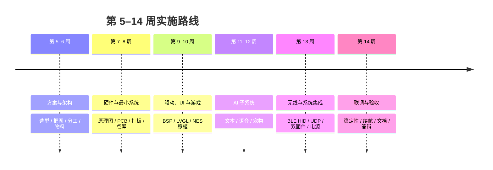

# 03 · 项目实现计划

> 依据《选题申请表》的“实施计划”：第 5–6 周方案、7–8 周硬件、9–10 周驱动与游戏、11–12 周 AI、13 周无线与系统、14 周联调验收。  
> 本文把它展开成可执行的任务清单、交付物与验收标准。

## 1. 项目范围

### 1.1 必须完成（MVP）

| 模块 | 内容 | 验收口径 |
|---|---|---|
| 硬件平台 | ESP32-S3 N16R8、ST7789、8 键（或 7 键 + 长按 START 复用 CTRL）、IMU、音频、SD、电池 | 打板/模块连线可稳定运行 |
| 主系统 | LVGL 菜单、设置、状态栏、电源管理 | 开机进 Launcher，页面可操作 |
| 游戏系统 | Retro-Go / nofrendo NES，SD 加载 ROM | 至少 10 个 ROM 可运行，≥30fps |
| AI 文本助手 | 屏幕键盘输入，云端 LLM 对话 | 能连续对话 10 轮 |
| AI 宠物 | 按键、IMU、语音三种互动 | 三种输入均有可见反馈 |
| 语音链路 | 录音 → 云端 ASR/LLM/TTS → 播放 | 端到端可完成一轮对话 |
| BLE HID | 键盘 + 手柄双模 | 电脑/手机可配对并操作 |
| Wi-Fi 音频 | 麦克风 → UDP → PC | PC 端可听到，延迟 <300ms |
| 双固件 | factory / ota_0 / ota_1 切换 | 菜单切换 + `START+B` 返回 |
| 电源 | 电量显示、低电保护、Light Sleep | 电量误差 <5%，睡眠可唤醒 |

### 1.2 可选（时间富余再做）

- AHT20 温湿度参与宠物环境互动。
- GB/GBC 等多机种模拟（Retro-Go 已支持，需额外 ROM 与测试）。
- OTA 升级（通过 Wi-Fi 更新主系统）。
- 自定义主题、开机动画、宠物皮肤。
- 电池充电曲线与更精确的电量计。

### 1.3 明确不做

- 天气、占卜、频谱分析仪（按《手柄实现方案》）。
- 音乐/视频播放器（参考项目有，但不在本次范围）。
- 商用外壳与量产认证；3D 打印外壳仅作演示。

## 2. 里程碑总览

| 周次 | 阶段 | 关键产出 | 里程碑（Gate） |
|---|---|---|---|
| 5–6 | 方案与架构 | 系统框图、引脚表、分区表、BOM v1、分工表 | 三人评审通过，关键物料下单 |
| 7–8 | 硬件与最小系统 | 原理图、PCB、焊接板、最小固件 | 屏幕点亮、按键可读、串口正常 |
| 9–10 | 驱动、UI、游戏 | BSP 驱动、LVGL 界面、NES 运行 | 游戏 ≥30fps，按键 <50ms |
| 11–12 | AI 子系统 | 文本对话、语音链路、AI 宠物 | 文本 10 轮、语音一轮、宠物三模态 |
| 13 | 无线与系统 | BLE HID、Wi-Fi 音频、双固件、电源 | 切换 50 次稳定，音频 <300ms |
| 14 | 联调与验收 | 最终固件、文档、演示视频 | 全部指标达标，答辩材料完成 |

## 3. 分阶段任务

### 第 5–6 周：方案与架构

**目标**：把“做什么、不做什么、怎么连、怎么分区”定死，避免后期返工。

| 任务 | 负责 | 产出 |
|---|---|---|
| 确认模组型号与内存/Flash | 硬件 | 模组规格截图、`esptool flash_id` 记录 |
| 确认屏幕、音频、IMU、SD、电池物料 | 硬件 | BOM v1、采购链接、到货时间 |
| 画系统框图与软件分层 | 系统 | `docs/01-系统框图.md` |
| 定引脚分配与分区表 | 硬件+系统 | 引脚表、`partitions.csv` 草案 |
| 画三子系统流程图 | 软件 | `docs/02-子系统流程图.md` |
| 三人分工与周排期 | 组长 | 分工表、每周检查点 |
| 建 Git 仓库、锁定 ESP-IDF 版本 | 软件 | 仓库、`README`、构建说明 |
| 建立 `CLAUDE.md` / `AGENTS.md`（可选） | 软件 | AI 编码工具配置 |

**验收**：

- 系统框图中每个外设都有明确接口（SPI/I2S/I2C/GPIO/ADC）。
- 分区表能放进 16MB Flash，且每个应用分区 ≤4MB。
- 三人对“必须做/可选/不做”无异议。
- 关键物料已下单，留出 1 周物流缓冲。

**风险**：物料选错（尤其是屏幕 FPC、麦克风型号、电池尺寸）。对策：先买 2 套关键物料，打板前做实物比对。

---

### 第 7–8 周：硬件与最小系统

**目标**：板子能亮、能烧、能按键；软件环境跑通。

| 任务 | 负责 | 产出 |
|---|---|---|
| 原理图：电源、USB-C、ESP32-S3、LCD、音频、按键、IMU、SD | 硬件 | 原理图 PDF |
| PCB：天线净空、电源走线、屏幕 FPC、按键布局 | 硬件 | Gerber、BOM、坐标文件 |
| 打板 + 贴片/手焊 | 硬件 | 实物板 |
| 上电前短路检查、3.3V/5V 测试 | 硬件 | 测试记录 |
| ESP-IDF 环境安装（建议锁定 v5.5.x） | 软件 | `idf.py --version` 记录 |
| Hello World / 串口 / 日志 | 软件 | 最小固件 |
| ST7789 点屏、背光 PWM | 软件 | 屏幕显示色块/文字 |
| 按键扫描与串口打印 | 软件 | 8 键键值日志 |

**验收**：

- 3.3V 电源纹波在可接受范围，上电无短路。
- 屏幕无花屏、无偏移（Y offset 正确）。
- 8 个按键都能被识别，抖动 <20ms。
- 串口能稳定输出日志，烧录成功。

**风险**：

- QFN 焊接连锡 → 用助焊剂 + 加热台，化锡后镊子压一下；打板前留测试点。
- 屏幕压碎 → 用 2mm 泡沫双面胶固定，装配时避免挤压。
- 天线性能差 → IPEX 天线远离电池与金属，保留净空。

---

### 第 9–10 周：驱动、UI 与游戏

**目标**：主系统有完整界面；NES 能跑起来。

| 任务 | 负责 | 产出 |
|---|---|---|
| ST7789 驱动 + DMA 双缓冲 | 底层 | 刷屏驱动 |
| LVGL v8.4 移植、中文字体、主题 | 底层 | Launcher / Menu / 设置页 |
| 按键驱动：消抖、长按、组合键 | 底层 | `key_driver` |
| IMU 驱动：姿态角、摇晃检测 | 底层 | IMU 数据接口 |
| 电池 ADC：采样、滤波、电量换算 | 底层 | 电量显示 |
| 音频：I2S 麦克风录音、功放播放、回环测试 | 底层 | 录音/播放 demo |
| SD 卡：FATFS 挂载、目录浏览 | 底层 | ROM 文件列表 |
| Retro-Go / nofrendo 移植 | 游戏 | NES 运行 |
| ROM 加载、画面缩放、音频输出 | 游戏 | 游戏 demo |
| 存档/读档 | 游戏 | `.sav` / 即时存档 |

**验收**：

- LVGL 界面切换无闪烁、无内存泄漏（连续切换 100 次堆水位稳定）。
- 按键响应 <50ms，长按/组合键识别正确。
- NES 至少 10 个 ROM 可运行，≥30fps，音频连续无爆音。
- SD 卡热插拔不崩溃（至少不重启）。

**风险**：

- LVGL 堆不足 → 屏幕对象及时 `lv_obj_del`，堆调到 64–96KB，开启动画精简。
- PSRAM DMA 崩溃 → 帧缓冲放 PSRAM，DMA 用内部 RAM bounce buffer。
- NES 性能不足 → 跳帧、降低缩放质量、优化 PPU 绘制。

---

### 第 11–12 周：AI 子系统

**目标**：文本对话可用；语音一轮跑通；宠物有基本互动。

| 任务 | 负责 | 产出 |
|---|---|---|
| Wi-Fi Manager：STA、重连、配网 | AI/无线 | 配网页面 |
| HTTPS 客户端、JSON 解析、流式响应 | AI/无线 | 文本对话 |
| 屏幕键盘（LVGL）与中文输入 | AI/无线 | 输入界面 |
| 云端 LLM API 接入、Key 管理 | AI/无线 | 对话 demo |
| 语音上行：I2S 录音 → VAD → Opus → WebSocket | AI/无线 | 录音上行 |
| 语音下行：TTS → 解码 → I2S 播放 | AI/无线 | 语音回复 |
| AI 宠物 UI：表情、动画、气泡 | AI/无线 | 宠物界面 |
| 宠物状态机：按键/IMU/语音 | AI/无线 | 三模态互动 |
| 异常与降级：离线、超时、重连 | AI/无线 | 稳定性日志 |

**验收**：

- 文本对话连续 10 轮不崩，首段响应 <3s（网络正常）。
- 语音一轮完整对话（录音→识别→回复→播放），端到端 <3s（目标）。
- 宠物对按键、摇晃、倾斜、翻转、语音均有可见反馈。
- 断网时宠物仍可本地互动，不崩溃。

**风险**：

- 云端服务不稳定 → 选可用的 LLM API，做超时/重试；演示前准备离线录屏。
- Opus 编码占用 CPU → 用固定码率（16–24kbps），必要时降采样。
- 音频回声 → 首版用 PTT（按住说话），不做全双工免提。

---

### 第 13 周：无线与系统集成

**目标**：BLE HID、Wi-Fi 音频、双固件、电源管理全部打通。

| 任务 | 负责 | 产出 |
|---|---|---|
| BLE HID 键盘：A/B/START/Ctrl+方向 | 无线 | 键盘模式 |
| BLE HID 手柄：按键/IMU 映射 | 无线 | 手柄模式 |
| 配对、重连、电量上报 | 无线 | 稳定性测试 |
| Wi-Fi 音频：PCM → UDP → PC 接收端 | 无线 | PC 接收脚本 |
| Wi-Fi 游戏/资源下载：HTTP → SD | 无线 | 下载页面与进度条 |
| 双固件分区、`esp_ota_set_boot_partition` | 系统 | 三固件切换 |
| `START+B` 返回主系统 | 系统 | 子固件退出 |
| 电量显示、低电保护、Light Sleep | 系统 | 电源管理 |
| 三系统连续切换测试 | 全员 | 测试报告 |

**验收**：

- BLE 键盘在 Windows/macOS/Android 至少 2 个平台可用，配对 <10s。
- Ctrl+方向键映射符合《手柄实现方案》：左全选、右剪切、上粘贴、下复制。
- Wi-Fi 音频局域网端到端 <300ms，连续 10 分钟无断流。
- 三固件连续切换 50 次，成功率 100%，无变砖。
- 睡眠/唤醒 100 次成功率 100%，待机电流 5–10mA。

**风险**：

- BLE 与 Wi-Fi 共存干扰 → 分时使用；游戏手柄模式关闭 Wi-Fi。
- 切换后外设未复位 → 每次启动重新初始化 I2S/SPI/背光，不假设寄存器状态。
- 休眠睡死 → 只用 Light Sleep + GPIO 唤醒，先做小实验再集成。

---

### 第 14 周：联调与验收

**目标**：稳定、能演示、文档齐全。

| 任务 | 负责 | 产出 |
|---|---|---|
| 全功能回归 | 全员 | 测试记录 |
| 2 小时连续运行（游戏/AI/待机） | 全员 | 稳定性报告 |
| 续航实测（满电到低电保护） | 硬件 | 续航曲线 |
| 内存水位与重启原因分析 | 软件 | 内存报告 |
| UI/交互打磨 | 软件 | 最终界面 |
| 文档整理、README、答辩 PPT | 全员 | 文档包 |
| 演示视频（3–5 分钟） | 组长 | 视频 |
| 验收答辩 | 全员 | 通过 |

**验收指标**（与选题申请表一致）：

| 指标 | 目标 | 测试方法 |
|---|---|---|
| NES 帧率 | ≥30fps | 屏幕 FPS 计数 / 逻辑分析仪 |
| 按键延迟 | <50ms | 高速摄像或 GPIO 打点 |
| Wi-Fi 音频延迟 | <300ms | PC 端录音对比 |
| 连续游戏续航 | ≥3 小时 | 满电到低电保护 |
| 整机成本 | <200 元 | BOM 汇总 |
| 开机时间 | <5s（主系统） | 秒表/日志时间戳 |
| 固件切换 | <8s | 秒表 |
| 电量误差 | <5% | 万用表对比 |
| 待机电流 | 5–10mA | 电流表 |
| 连续运行 | 2 小时无崩溃 | 压力测试 |

## 4. 三人分工

> 选题申请表已给出三条分工线，下面细化为可执行职责。姓名按组内实际情况填写。

| 角色 | 对应申请表分工 | 主要职责 | 关键周次 |
|---|---|---|---|
| A · 硬件/系统 | 系统总体方案与硬件设计 | 选型、原理图、PCB、电源、焊接调试、分区规划、结构 | 5–8、13–14 |
| B · 底层/UI | 底层驱动与系统框架 | ST7789、LVGL、按键、IMU、音频、SD、主题、内存优化 | 7–12 |
| C · AI/无线 | AI 与无线功能 | NES 移植、AI 文本/语音、宠物、Wi-Fi 音频、BLE HID | 9–14 |

**交叉评审**：每周至少一次三人代码/硬件评审；A 与 B 互查驱动，B 与 C 互查界面与网络，C 与 A 互查电源与无线。

**每周节奏**：

- 周一：定本周目标与风险。
- 周三：中期演示（哪怕只是串口日志）。
- 周五：合并代码、更新文档、记录问题。
- 每周至少一次完整构建 + 烧录，保持主干可运行。

## 5. 技术路线与复用策略

| 模块 | 路线 | 参考项目 | 复用程度 |
|---|---|---|---|
| 主系统框架 | ESP-IDF + LVGL v8.4 + App Manager | ESP-Handheld `main/` | 高（改引脚/删模块） |
| 显示 | ST7789 SPI + DMA | `st7789_driver.c` | 高 |
| 游戏 | Retro-Go + nofrendo | `retro-go-firmware/`、`components/retro-go` | 高 |
| AI | XiaoZhi 语音链路 + 自研宠物 UI | `xiaozhi-zistar-main/` | 中（板级复用，宠物新增） |
| BLE HID | Bluedroid HID | `modules/pc_remote/ble_hid.c` | 高 |
| Wi-Fi 音频 | UDP PCM | `modules/pc_remote/wifi_audio.c` | 高 |
| 双固件 | 三分区 + otadata | `partitions.csv` | 高 |
| 电源 | ADC + Light Sleep | `modules/power/` | 中（修复休眠） |

**复用原则**：

1. **先跑通参考项目，再做减法**：用参考项目的板级配置点屏、跑游戏、跑 AI，确认硬件链路无误后再删模块。
2. **锁定版本**：记录 ESP-IDF 版本、参考仓库 commit、LVGL 版本；避免“昨天能编译今天不能”。
3. **保留许可证与版权声明**：GPL v2 组件不能删掉声明（详见 04）。
4. **不要直接改第三方子模块**：把改动放在 `main/` 或 `patches/`，便于升级。

## 6. 测试计划

### 6.1 模块测试

| 模块 | 测试项 | 通过标准 |
|---|---|---|
| 电源 | 3.3V 输出、充电、过放保护、ADC 精度 | 电压误差 <2%，电量误差 <5% |
| 屏幕 | 颜色、偏移、刷新、背光 | 无花屏/偏移，刷新无撕裂 |
| 按键 | 8 键、长按、组合键、消抖 | 100% 识别，误触 <1% |
| IMU | 静止噪声、倾斜角、摇晃检测 | 倾斜误差 <5°，摇晃识别率 >90% |
| 音频 | 录音信噪比、播放无爆音、回环 | 可懂度良好，无持续杂音 |
| SD | 挂载、读写、热插拔 | 读写稳定，热插拔不崩溃 |
| BLE | 配对、重连、键值 | 2 平台可用，重连 <5s |
| Wi-Fi | 配网、重连、弱网 | 配网 <60s，断网自动重连 |

### 6.2 集成测试

| 场景 | 步骤 | 通过标准 |
|---|---|---|
| 三固件切换 | 主→游戏→主→AI→主，循环 50 次 | 100% 成功，无变砖 |
| 长时间游戏 | 连续 2 小时 NES | 无崩溃，帧率 ≥30fps |
| 长时间 AI | 连续 10 轮文本 + 5 轮语音 | 无 OOM，响应正常 |
| 低电保护 | 放电到 3.3V | 保存状态并休眠/关机 |
| 休眠唤醒 | 100 次 | 100% 唤醒 |
| 弱网 | 限速/丢包 | 超时提示，不崩溃 |
| 充电 | 边充边玩 | 不重启，电量上升 |

### 6.3 验收演示脚本（建议 5 分钟）

1. 开机进主系统，展示状态栏、电量、菜单（30s）。
2. 进入游戏系统，跑一个 NES 游戏，展示画面/音频/存档（60s）。
3. 返回主系统，切换 BLE 键盘，在电脑上输入文字，演示 Ctrl+方向键（60s）。
4. 切换 AI 系统，文本问一个问题，展示流式回答（45s）。
5. 语音对话一轮，展示宠物表情与语音回复（45s）。
6. 展示 Wi-Fi 音频到 PC、低电提示、休眠唤醒（30s）。
7. 收尾：三固件切换、成本与指标总结（30s）。

## 7. 风险与应对

| 风险 | 概率 | 影响 | 应对 | 负责人 |
|---|---|---|---|---|
| 物料到货延迟/型号错误 | 中 | 高 | 第 5 周下单；关键件买 2 套；先用开发板验证 | A |
| PCB 打板/焊接失败 | 中 | 高 | 留测试点；先焊电源再焊 MCU；准备第二版 | A |
| PSRAM/DMA 冲突导致崩溃 | 高 | 中 | 帧缓冲 PSRAM + 内部 DMA buffer；早做压力测试 | B |
| LVGL 内存泄漏 | 中 | 中 | 页面删除规范；堆水位日志；100 次切换测试 | B |
| NES 性能不足 | 中 | 中 | 跳帧、降低缩放、优化 PPU；先保证 30fps | C |
| 云端 AI 服务不稳定 | 高 | 中 | 多 provider/超时重试；演示准备离线录屏 | C |
| BLE/Wi-Fi 共存干扰 | 中 | 中 | 分时使用；手柄模式关 Wi-Fi | C |
| 休眠睡死 | 中 | 高 | 只用 Light Sleep + GPIO 唤醒；100 次测试 | B |
| 双固件切换变砖 | 低 | 高 | 保留 factory 回退；切换前校验；串口救砖 | A |
| 进度延误 | 中 | 高 | 每周 Gate；砍可选功能（AHT20/多机种/OTA） | 组长 |
| GPL 合规问题 | 低 | 中 | 保留声明；发布源码；不使用商业 ROM | 全员 |

## 8. 交付物清单

### 8.1 硬件

- [ ] 原理图 PDF
- [ ] PCB Gerber / BOM / 坐标文件
- [ ] 3D 打印外壳 STL/STEP（可选）
- [ ] 实物样机 1–2 台
- [ ] 测试记录（电压、电流、续航）

### 8.2 软件

- [ ] `factory` 主系统固件
- [ ] `ota_0` 游戏系统固件
- [ ] `ota_1` AI 系统固件
- [ ] 分区表、烧录脚本、构建说明
- [ ] PC 端 Wi-Fi 音频接收脚本
- [ ] 三套固件的源码与版本记录

### 8.3 文档

- [ ] 系统框图（本文档 01）
- [ ] 子系统流程图（本文档 02）
- [ ] 实现计划（本文档 03）
- [ ] 参考项目分析（本文档 04）
- [ ] 用户手册（按键、配网、切换、充电）
- [ ] 测试报告（指标、问题、修复）
- [ ] 答辩 PPT 与演示视频

## 9. 每周检查清单

每周五对照：

- [ ] 本周目标是否完成？未完成的原因是什么？
- [ ] 主干代码是否可编译、可烧录？
- [ ] 是否有新的内存/性能问题？
- [ ] 文档是否同步更新？
- [ ] 下周依赖的物料/服务是否就绪？
- [ ] 风险表是否需要调整？
- [ ] 是否需要砍功能保进度？

> 建议把“可演示”作为每周硬指标：宁可功能少，也不要到第 14 周才发现主链路不通。
